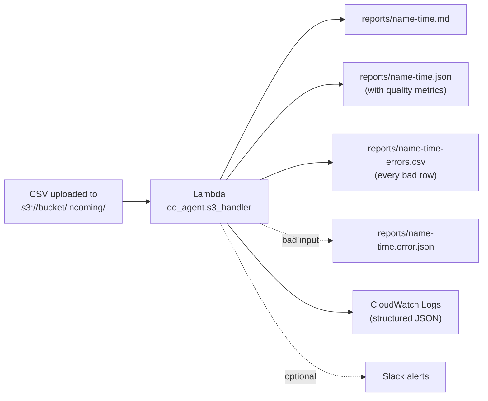

# shipment-dq-agent

Data quality audits for shipment tracking data. Upload a CSV (or point it at a Google Sheet) and it **adapts when column names change**, runs 12 checks, reports **quality metrics and an SLA verdict**, lists every bad row, and sends **routed alerts to Slack**. It also runs as an **S3-triggered AWS Lambda**.

   

> **About this project**
> - A clean-room rebuild of an approach I used in a previous data quality role to replace manual QC checks. It uses **only synthetic data** and shares no code, configuration, data or internal naming with any employer.
> - **Built with AI assistance** (Claude). I deployed it on AWS myself, debugged the deployment, and wrote up the design decisions below.

## Architecture



The same audit engine also runs from the command line on a CSV or Google Sheet, and on a schedule with GitHub Actions.

## What it does

| Capability | How |
|---|---|
| **Schema-drift handling** | Headers are mapped to a fixed schema by exact name, known synonyms, token/fuzzy match, then (optionally) an LLM for leftovers. Renamed, reordered and extra columns are handled and reported. |
| **12 data quality checks** | Duplicates, empty required fields, invalid statuses, unparseable timestamps, delivered-before-pickup, ETA-before-pickup, status/timestamp contradictions, future timestamps, stale in-transit shipments, data freshness, missing required columns. |
| **Quality metrics + SLA** | Total, valid and invalid records, error rate, errors by type, and whether the run meets a configurable SLA. See the [data contract](docs/data-contract.md). |
| **Row-level error file** | `*-errors.csv` lists every bad row with its spreadsheet row number, so the data owner can fix the source. |
| **Reliable failure handling** | Bad input is recorded as `.error.json` and not retried. Unexpected errors are logged and re-raised so Lambda's retry and alarms apply. |
| **Structured logs** | One JSON object per line, queryable in CloudWatch Logs Insights. |
| **Alert routing** | A summary goes to a default Slack channel. Exceptions are routed to data-ops, carrier-ops or on-call by check or severity. |

## Quickstart (2 minutes, no accounts needed)

```bash
git clone https://github.com/BaneBoi1738/shipment-dq-agent.git
cd shipment-dq-agent
python -m venv .venv
source .venv/bin/activate          # Windows: .venv\Scripts\activate
pip install -e ".[dev]"

# 1. Fake shipments with planted problems AND renamed/reordered columns
dq-agent generate --rows 500 --drift --out data/sample.csv

# 2. Audit them (--dry-run prints the Slack messages instead of sending)
dq-agent audit --path data/sample.csv --output-errors data/errors.csv --dry-run

# 3. Run the tests
pytest -q
```

### Example output

```
# Shipment data quality: FAIL
- Rows audited: 505        - Clean rows: 87.9%
- Findings: 2 critical, 8 warning
- SLA (clean rows >= 95%): not met

## Quality metrics
| Total records | 505 |    | Valid records | 444 |
| Invalid records | 61 |   | Error rate | 12.1% |

## Schema drift
- `Tracking Number` -> `shipment_id` (synonym, 0.97)
- `Estimated Delivery` -> `eta` (synonym, 0.97)
- New/unrecognised columns (ignored): `Internal Notes`
```

Full sample: [`docs/sample_report.md`](docs/sample_report.md). The demo's renamed headers are in the built-in synonym list; typos and unseen names go through the fuzzy and optional LLM stages (see `tests/test_schema.py`).

## Deploy on AWS (S3 -> Lambda -> S3)

```bash
python aws/build_lambda_zip.py     # creates aws/lambda.zip (~1.5 MB, Python 3.12, x86_64)
```

Then follow the click-by-click guide in [`docs/aws-deploy.md`](docs/aws-deploy.md): create a bucket with `incoming/` and `reports/` prefixes, create the function, attach the *AWS SDK for pandas* layer, add the least-privilege policy from `aws/iam-policy.json`, and add an S3 trigger on `incoming/`.

Design choices worth knowing:
- **Separate input and output prefixes**, so the trigger can never fire on the Lambda's own output. The handler also skips anything under `reports/` as a second safety net.
- **Least-privilege IAM:** read `incoming/*`, write `reports/*`, nothing else.
- **Failures split by cause:** retrying a corrupt file is pointless, but retrying an S3 outage is right. See the [data contract](docs/data-contract.md).
- **Reports declare UTF-8**, so emoji and arrows render correctly in browsers.

## Checks

| Check | Default severity | What it catches |
|---|---|---|
| `missing_required_columns` | critical | A required column is gone and could not be matched |
| `duplicate_shipment_id` | critical | Same ID on more than one row |
| `delivered_before_pickup` | critical | `delivered_at` earlier than `picked_up_at` |
| `data_freshness` | critical | Newest `last_update` older than 24h |
| `missing_required_values` | warning (critical at 5%) | Empty or null-like required fields |
| `invalid_status` | warning (critical at 5%) | Status not in the allowed list |
| `unparseable_timestamps` | warning (critical at 5%) | Dates such as `TBD` or `32/13/2026` |
| `eta_before_pickup` | warning (critical at 5%) | ETA earlier than pickup |
| `delivered_status_missing_timestamp` | warning (critical at 5%) | Status `delivered` but no delivery time |
| `timestamp_on_undelivered` | warning (critical at 5%) | Delivery time set but status is not delivered |
| `future_timestamps` | warning (critical at 5%) | Pickup, delivery or update in the future |
| `stale_in_transit` | warning (critical at 10%) | In-transit with no update for 48h+ |

Thresholds, allowed statuses, synonyms, the SLA and routing live in `src/dq_agent/default_config.yaml`. Copy it to `config.yaml` to override; your file is merged over the defaults.

## Other ways to run it

**Google Sheets:** create a service account with the Sheets and Drive APIs enabled, share the sheet with its email, then:
```bash
pip install -e ".[sheets]"
export GOOGLE_SHEET_ID=<id from the sheet URL>
export GOOGLE_APPLICATION_CREDENTIALS=service_account.json
dq-agent audit --source sheets
```

**Slack:** create incoming webhooks and set `SLACK_WEBHOOK_URL` (default channel) plus optional `SLACK_WEBHOOK_DATA_OPS`, `SLACK_WEBHOOK_CARRIER_OPS`, `SLACK_WEBHOOK_ONCALL`, then add `--post-slack`. Routes without a webhook are skipped and logged.

**Daily schedule:** `.github/workflows/daily-audit.yml` runs at 09:00 IST and uploads the report as an artifact. Without sheet secrets it runs the synthetic demo.

**Optional LLM column mapping:** `export ANTHROPIC_API_KEY=...` and add `--llm`. Only unmapped headers and up to three sample values per column are sent, and the answer is validated and ignored if invalid.

## CLI

```
dq-agent generate [--rows N] [--seed N] [--drift] [--out PATH]
dq-agent audit [--source csv|sheets] [--path PATH] [--sheet-id ID] [--worksheet NAME]
               [--config PATH] [--post-slack] [--dry-run] [--llm]
               [--output-md PATH] [--output-json PATH] [--output-errors PATH]
               [--fail-on critical|warning|never]
```

Exit codes: `0` ok, `1` findings at the `--fail-on` level, `2` setup or input error.

## Project layout

```
src/dq_agent/
  schema.py          header mapping and drift report
  checks.py          the 12 checks and severity logic
  audit.py           orchestration, quality metrics, SLA, error details
  slack.py           message building, routing, delivery
  sources.py         CSV and Google Sheets readers
  generate_data.py   synthetic data with planted problems
  report.py          Markdown report
  cli.py             command line
  s3_handler.py      S3-triggered Lambda: audit, metrics, structured logs, failure handling
  lambda_handler.py  generic Lambda entry point (CSV path or Google Sheet)
aws/                 build script, IAM policy, test event
docs/                data contract, AWS deploy guide, architecture, sample report
tests/               68 tests
```

## Limitations

- Developed and tested on synthetic data. The S3 -> Lambda flow was deployed and run in a real AWS account; the Google Sheets reader and live Slack webhooks have not been run against real services.
- Checks are rule-based. They flag problems; they do not fix data.
- Timestamps without a timezone are treated as UTC.
- Reads the whole file each run: fine for tens of thousands of rows, not millions.

## Roadmap

- [x] S3-triggered Lambda audit
- [x] Quality metrics, SLA flag, per-row error file, structured logs, failure handling
- [ ] Terraform / CDK for Lambda + S3 trigger + IAM
- [ ] EventBridge schedule and Secrets Manager for webhooks
- [ ] Per-carrier thresholds and owners
- [ ] Trend tracking across runs (clean rate over time)

## License

MIT, see [LICENSE](LICENSE).

## Live demo: "Break my data quality checker"

A Streamlit app wraps the same audit engine the AWS Lambda uses. Upload any shipment CSV (any column names or order) and get the quality metrics, errors by type, schema mapping, findings, and downloadable reports.

```bash
pip install -r requirements.txt
streamlit run app.py
```

Public demo guardrails: 10 MB / 50,000 rows, processed in memory, nothing stored. Non-UTF-8 (Latin-1) files are converted instead of rejected; empty or header-only files are rejected with a clear message, the same non-retryable path the Lambda uses.

### Bug found while stress-testing (Day 12)
A file using `ship_id` as the ID column failed the whole audit ("missing required column: shipment_id") because that name wasn't a known synonym. Fixed by extending the synonym list and added a regression test (`test_ship_id_maps_to_shipment_id`). Lesson: schema mapping needs real-world naming variety, not just the names I thought of.
